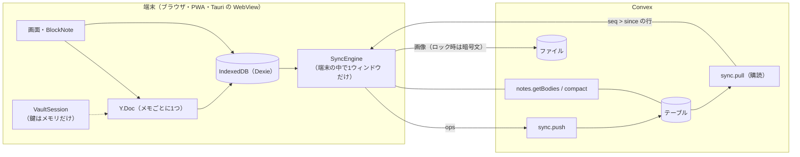
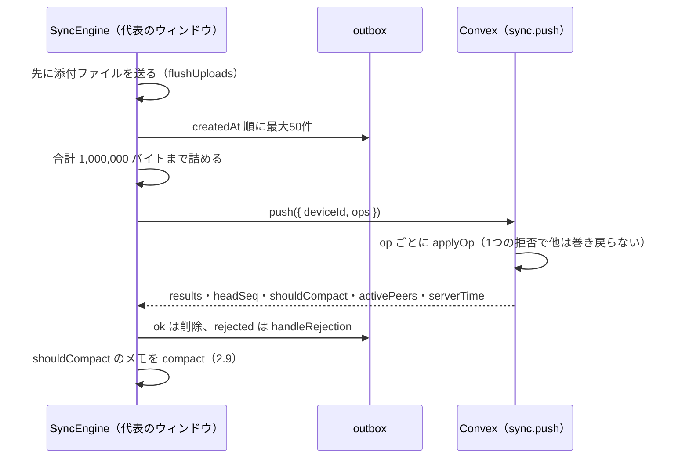
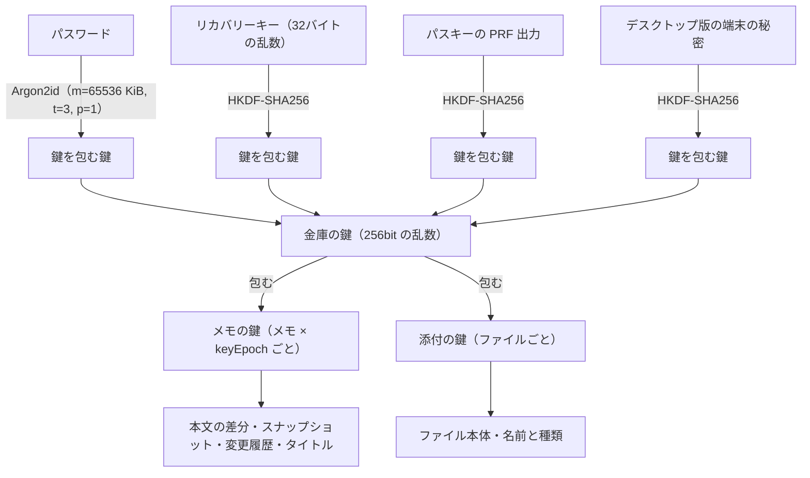
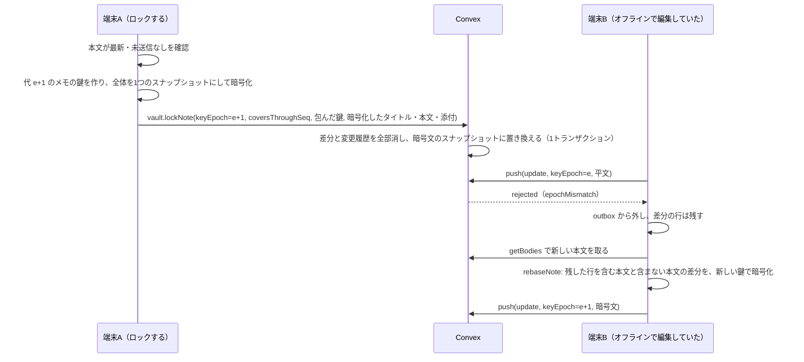
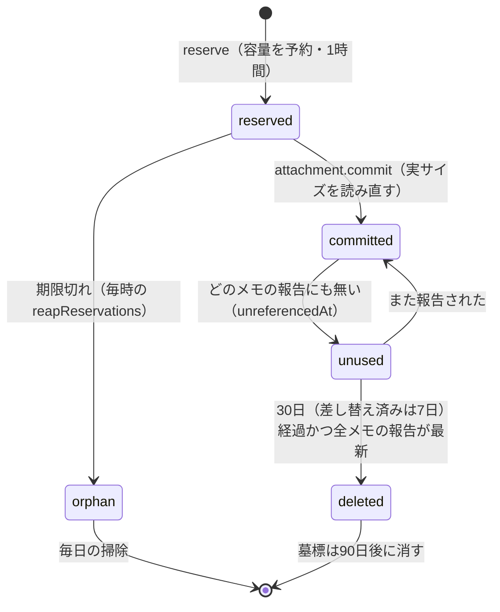

<h1 align="center">Memoca — 実装詳細</h1>

本資料は、[作品説明資料](https://github.com/mocaluna0117/memoca/blob/main/docs/portfolio/PORTFOLIO.md) で挙げた工夫が**コードの上でどう実装されているか**をまとめたものである。データ構造・通信の手順・パラメータ・担当する関数を、ソースへのリンク付きで示す。作った動機や測った結果は作品説明資料に書いたので、ここでは繰り返さない。特に厚く書いたのは、オフライン同期（2章）とロックの暗号化（3章）である。

---

## 1. 全体の構成

### 1.1 3つの部品

| 部品 | 担当 | 主なコード |
|---|---|---|
| Webアプリ（Next.js の PWA） | 画面・エディタ・同期エンジン・暗号・検索・画像の圧縮。**端末の IndexedDB を一次の保存先**にし、画面はそこだけを読んで描く | [`src/lib/`](https://github.com/mocaluna0117/memoca/blob/main/src/lib) |
| Convex | 利用者ごとの書き込み順（seq）の発行、行の保存と配信、容量の計算、ファイル置き場、定期処理（cron） | [`convex/`](https://github.com/mocaluna0117/memoca/blob/main/convex) |
| デスクトップ版（Tauri） | 本番のサイト（`https://memoca-app.vercel.app`）を2つのウィンドウに表示する殻。ホットキー、メニューバー、ログインの受け渡し、Touch ID / Windows Hello、自動更新 | [`desktop/src-tauri/`](https://github.com/mocaluna0117/memoca/blob/main/desktop/src-tauri) |

デスクトップ版はアプリの画面を同梱しない。[`tauri.conf.json`](https://github.com/mocaluna0117/memoca/blob/main/desktop/src-tauri/tauri.conf.json) の `frontendDist` が本番の URL を指しており、Web版と同じコードが WebView の中で動く。



### 1.2 データの置き場所

| データ | 端末（[`src/lib/db/index.ts`](https://github.com/mocaluna0117/memoca/blob/main/src/lib/db/index.ts)） | サーバー（[`convex/schema.ts`](https://github.com/mocaluna0117/memoca/blob/main/convex/schema.ts)） |
|---|---|---|
| フォルダ・メモの属性 | `folders` / `notes` | `folders` / `notes` |
| 本文 | `updates`（Yjs の差分。未送信は `pushed: 0`）、`snapshots` | `noteUpdates`（追記のみ）、`noteSnapshots`（1メモ1行） |
| 検索用の本文・読み | `bodies`（抜き出した本文・リンク先・読み・どの seq まで持っているか） | なし |
| 送信待ち | `outbox` | — |
| 添付 | `attachments`、`pendingUploads`、`blobs`（平文のファイルだけ） | `attachments`、`attachmentRefs`、ファイル |
| 金庫 | `meta.vaultRecord`（包んだ鍵だけ）、`meta.deviceUnlock`（デスクトップ版） | `vaults` |
| 変更履歴 | — | `noteVersions`（ファイルに保存） |

---

## 2. オフライン同期

### 2.1 端末での書き込み: 先に保存し、outbox に積む

ユーザーの操作はすべて「端末の DB に書く → outbox に op を積む」の順で処理する（[`src/lib/sync/mutations.ts`](https://github.com/mocaluna0117/memoca/blob/main/src/lib/sync/mutations.ts)）。画面は DB しか見ないので、オフラインでも操作は変わらない。

本文はメモごとに1つの `Y.Doc` を持ち、BlockNote はその XmlFragment `"body"` を編集する（[`ydoc.ts`](https://github.com/mocaluna0117/memoca/blob/main/src/lib/sync/ydoc.ts)）。[`docs.ts`](https://github.com/mocaluna0117/memoca/blob/main/src/lib/sync/docs.ts) の `openHandle` は `doc.on("update")` で自分の編集だけをバッファに積み、**500ms（`FLUSH_MS`）ごとに `flush` で1つの差分にまとめて**保存する。

```ts
// src/lib/sync/docs.ts — flush（抜粋）
while (handle.writing) await handle.writing.catch(() => {});
if (handle.buffer.length === 0) return;
const merged = handle.buffer.length === 1 ? handle.buffer[0]! : Y.mergeUpdates(handle.buffer);
handle.buffer = [];
const writing = write(handle, merged).catch((error: unknown) => {
  handle.buffer.unshift(merged); // 書けなかった差分は先頭に戻し、次の flush で一緒に書く
  throw error;
});
```

- **1つのメモの書き込みは直列**にする（前の `writing` を待つ）。後の差分が先に保存されると、Yjs は前提の差分が無いものとして適用を保留するからである
- `write` は `updates` への追加と `outbox` への追加を**1つの Dexie トランザクション**で行う。片方だけ残る状態を作らない
- ロックしたメモは、保存する前に暗号化する。金庫が閉じていて暗号化できなければ、**どこにも書かずにバッファに残す**
- 本文の1行目（一覧の抜粋 `preview`）は、タイトルを含まない専用の op で送る（2.3）。抜粋が変わらない編集では、一覧の並びに使う `updatedAt` の書き換えを10秒に1回（`STAMP_EVERY_MS`）に抑えている

### 2.2 まとめ方1: 本文は Yjs（CRDT）

本文は Yjs の差分のまま送り、**サーバーはマージしない**。ロックしたメモの差分は暗号文なので、サーバーでは扱えないからである。受け取った端末が `Y.applyUpdate` する。Yjs の適用は冪等なので、取り直しで重なって届いても害はない（[`notes.ts`](https://github.com/mocaluna0117/memoca/blob/main/convex/notes.ts) の `getBodies` のコメント）。

古い版のアプリが、新しい版の書式（文字の大きさ）付きの文字を受け取ると、y-prosemirror の `attributesToMarks` が例外を投げ、その文字が Yjs から削除されて全端末に広がっていた。[`patches/y-prosemirror@1.3.7.patch`](https://github.com/mocaluna0117/memoca/blob/main/patches/y-prosemirror@1.3.7.patch) で、**スキーマに無い mark は読み飛ばして文字を残す**ようにした（[`tests/unknown-marks.test.ts`](https://github.com/mocaluna0117/memoca/blob/main/tests/unknown-marks.test.ts)）。

### 2.3 まとめ方2: 属性は「項目のまとまりごとの後勝ち」

本文以外の属性は、**まとまりごとに印（stamp）を持ち、印が大きい方を残す**。印は `{ t: 時刻ms, d: 端末ID }` で、比べる関数は端末とサーバーで同じものを使う（[`src/lib/hlc.ts`](https://github.com/mocaluna0117/memoca/blob/main/src/lib/hlc.ts) と [`convex/lib/hlc.ts`](https://github.com/mocaluna0117/memoca/blob/main/convex/lib/hlc.ts)）。

```ts
export function isNewer(candidate: Stamp, current: Stamp): boolean {
  if (candidate.t !== current.t) return candidate.t > current.t;
  return candidate.d > current.d; // 同じミリ秒なら端末IDで決める
}
```

印は [`clock.ts`](https://github.com/mocaluna0117/memoca/blob/main/src/lib/sync/clock.ts) の `stamp()` が作る。`last = max(Date.now() + offset, last + 1)` とするので、同じ端末の中では**重ならず、戻らない**（ハイブリッド論理時計）。`last` は2秒遅れで `meta.lastHlc` に保存する。端末 ID はブラウザのプロファイルごとの UUIDv7 である（[`meta.ts`](https://github.com/mocaluna0117/memoca/blob/main/src/lib/db/meta.ts) の `deviceId`）。

| 対象 | 印 | その印で動く値 |
|---|---|---|
| フォルダ | `name` | 名前・アイコン |
| | `place` | 親フォルダ・並び順 |
| | `trash` | ゴミ箱に入れた時刻 |
| | `lock` | ロックの有無 |
| メモ | `title` | タイトル（ロック時は暗号文） |
| | `preview` | 一覧の抜粋（本文の1行目） |
| | `place` | フォルダ・並び順 |
| | `pin` / `pinPlace` | ピン留めの有無 / ピン留めの中での位置 |
| | `trash` | ゴミ箱に入れた時刻 |
| | `lock` | ロック・`keyEpoch`・包んだ鍵（サーバーのロック処理だけが動かす） |

サーバーは [`convex/sync.ts`](https://github.com/mocaluna0117/memoca/blob/main/convex/sync.ts) の `applyNoteOp` / `applyFolderOp` で、届いた op のまとまりごとに `isNewer` を確かめて上書きする。端末は受信時に [`apply.ts`](https://github.com/mocaluna0117/memoca/blob/main/src/lib/sync/apply.ts) の `mergeNote` / `mergeFolder` で**同じ規則**を当てる。そのため、まだ送っていない手元の改名が、受信した古い行で一瞬戻ることもない。

`preview` が `title` と別の印になっているのは、作品説明資料の「本文を書いただけでタイトルが空に戻る」不具合の修正である。本文の保存のたびに送る op は `preview` だけを運び、タイトルを運ばない（[`noteOpV`](https://github.com/mocaluna0117/memoca/blob/main/convex/lib/ops.ts)）。ロックの状態だけは端末で推測せず、印が新しいか `keyEpoch` が違えばサーバーの値をそのまま取る。

### 2.4 時計のずれ

- **サーバー**: `isFromTheFuture` が `stamp.t > now + 60_000`（`MAX_CLOCK_SKEW_MS`）の印を見つけると、その op を `clockSkew` で拒否する（[`constants.ts`](https://github.com/mocaluna0117/memoca/blob/main/convex/lib/constants.ts)）
- **端末**: pull と push の応答はすべて `serverTime` を含む。`syncClock` は `serverTime - Date.now()` が今の補正値から1秒以上ずれたら補正値を更新し、`meta.clockOffset` に保存する。以後の印はこの補正済みの時刻で作られる
- 拒否された op は、[`engine.ts`](https://github.com/mocaluna0117/memoca/blob/main/src/lib/sync/engine.ts) の `handleRejection` で outbox に残して**印はそのまま最大3回まで送り直し**、それでも拒否されれば捨てる

### 2.5 サーバーが決める順番: 利用者ごとの seq

受信の目印に時刻は使わない。利用者ごとに1行の `syncHeads` を持ち、同期対象の行を書く mutation は必ず [`convex/lib/seq.ts`](https://github.com/mocaluna0117/memoca/blob/main/convex/lib/seq.ts) の `openSeq` でこの行を読み、書く行ごとに `next()` で番号を進め、最後に `commit()` で書き戻す。

同じ利用者の mutation はすべてこの1行を読み書きするので、Convex の楽観的同時実行制御で直列に処理される。**後に確定したトランザクションほど大きい seq を持つ**ことが保証され、端末は「N より後をください」というカーソルだけで、取りこぼしなく続きを受け取れる。

`syncHeads.lastPushByDevice` には端末ごとの最後の送信時刻を最大10台分持つ。push の応答の `activePeers`（3分以内に送った他の端末の数）が1以上なら、端末は送信の巡回を5秒から1秒に縮める。

### 2.6 送信（push）



op は `folder`・`note`・`update`（Yjs の差分）・`attachment.commit` の4種類である（[`convex/lib/ops.ts`](https://github.com/mocaluna0117/memoca/blob/main/convex/lib/ops.ts)）。同じ op が2回届いても結果は変わらない。`update` は `opId` を `by_user_op` インデックスで引いて、あれば何もせず `ok` を返す。属性の op は後勝ちなので、2回目は何も変えない。`attachment.commit` は確定済みなら `ok` を返す。

| 拒否の理由 | サーバーの条件 | 端末の対応 |
|---|---|---|
| `clockSkew` | 印が60秒より先 | 2.4 のとおり |
| `epochMismatch` | `update` の `keyEpoch` がメモの現在の代と違う | outbox からは外すが、手元の差分の行は残し、`rebaseNote` で新しい代の差分に作り直す（3.3） |
| `quotaExceeded`（本文） | 使用量＋予約＋差分 > 上限 | 捨てずに `retryAt` を60秒後にして残し、「保存されていない」と表示する |
| `plaintextIntoLockedNote` など | ロック中のメモに平文、など | 捨てる |

送信は outbox の変化（250ms 後）、`online`・`visibilitychange`・`pagehide`、5秒（または1秒）の巡回で始まる。送信中に次の送信を頼まれたら `again` を立て、終わった直後にもう一度送る（作品説明資料の「送信中に頼まれた次の送信を捨てていた」の修正）。

### 2.7 受信（pull）

端末は `client.watchQuery(api.sync.pull, { since })` で Convex のリアルタイム購読を張る。`pull` は5つの表（`folders`・`notes`・`noteUpdates`・`noteSnapshots`・`attachments`）を、それぞれ `by_user_seq` インデックスで `seq > since` から最大300行（`PULL_PAGE_LIMIT`）読む。Yjs の差分には別に 700,000 バイト（`PULL_BYTE_BUDGET`）の上限を掛ける。ただし大きすぎる1件でカーソルが止まらないよう、最低1件は通す。

表ごとにページを切るので、一番大きい seq までカーソルを進めると、先に満杯になった表の残りを飛ばしてしまう。そこで**満杯になった表の最後の seq のうち最小の値**をカーソルにし、それより後の行は捨てて次回に回す。

```ts
// convex/sync.ts — pull（抜粋）
for (const page of pages) {
  for (const row of page.rows) if (row.seq > maxSeen) maxSeen = row.seq;
  if (page.full && page.rows.length > 0) {
    cursor = Math.min(cursor, page.rows[page.rows.length - 1]!.seq);
  }
}
if (!Number.isFinite(cursor)) cursor = Math.max(maxSeen, since);
```

- **スナップショットは見出しだけ**を配る。本文が必要な端末だけが `notes.getBodies` に `{ noteId, haveThroughSeq }` を渡して取りに行く（1回64件・差分は1メモ400件まで）。大きいスナップショットはファイルの URL で返し、端末は `cache: "no-store"` で取る
- 端末の `applyBatch` は、受け取った全行を**8つの表にまたがる1つのトランザクション**で書く。書く表をトランザクションに列挙し忘れると、その回の受信全体が失敗し、カーソルが進まないまま同じ所で失敗し続ける。作品説明資料の「1回の失敗で同期が永久に止まる」は、この列挙漏れだった
- 自分が送った差分が戻ってきたら、`opId` で見分けて `seq` と `pushed: 1` を記録するだけにする
- 受け取ったカーソルが進んでいれば、**その位置から購読を張り直す**（`receive` の最後）。始めた位置のままだと、変更のたびに同じ範囲を受け取り直すことになる

### 2.8 フォルダの循環

A で「F1 を F2 の中へ」、B で「F2 を F1 の中へ」と移すと、合わせて輪になる。seq の直列化により後から来た移動は先の移動を必ず見られるので、`applyFolderOp` は移動のあとに `repairCycle` で親をたどる。

```ts
// convex/sync.ts — repairCycle（抜粋）
while (current?.parentId) {
  if (seen.has(current.parentId) || ++depth > MAX_FOLDER_DEPTH) { // 64段
    const place = { t: Math.max(now, self.ts.place.t + 1), d: deviceId };
    await ctx.db.patch(self._id, { parentId: null, ts: { ...self.ts, place }, ... });
    return true;
  }
  ...
}
```

輪になったフォルダは最上位へ移す。このとき、移動した側の印より**1ms 以上新しい印**を付けるのが要点である。同じ印だと、移動した端末は自分の値を残してしまい、輪が端末の中に残るからである。

### 2.9 差分の圧縮

差分が64件（`COMPACT_UPDATE_COUNT`）か 256KiB（`COMPACT_UPDATE_BYTES`）たまると、push の応答の `shouldCompact` で端末に知らせる。ロックしたメモはサーバーでマージできないので、**圧縮は端末が行う**（[`engine.ts`](https://github.com/mocaluna0117/memoca/blob/main/src/lib/sync/engine.ts) の `compact`）。

- 端末は、手元の本文が最新（`bodies.throughSeq === note.lastUpdateSeq`）で、代が一致し、未送信の差分が無いときだけ、全体を `Y.encodeStateAsUpdate` してスナップショットにする
- サーバー（`notes.compact`）は `coversThroughSeq !== note.lastUpdateSeq` なら `behind` で拒否する。**消す差分をすべて見た端末だけが圧縮できる**、という証明である
- 受け付けたら、前のスナップショットを消して新しいものを入れ、`seq <= coversThroughSeq` の差分を500件ずつ消す（残りはスケジューラで続ける）

### 2.10 1台の中の複数ウィンドウ

- サーバーと同期するのは端末の中で1ウィンドウだけにする。`navigator.locks.request("memoca-sync", { mode: "exclusive" })` を取れたウィンドウだけが購読と送信を行う（`claimLeadership`）
- ウィンドウどうしは BroadcastChannel `"memoca-sync"` で3種類のメッセージを送り合う（[`peers.ts`](https://github.com/mocaluna0117/memoca/blob/main/src/lib/sync/peers.ts)）

| メッセージ | 意味 |
|---|---|
| `outbox` | 送るものがある。代表のウィンドウがすぐ送る |
| `update`（noteId, update） | ロックしていないメモの差分。開いているウィンドウが取り込む |
| `reload`（noteId） | ロックしたメモが変わった。各ウィンドウが自分の金庫で DB から読み直す。平文はウィンドウの間で渡さない |

### 2.11 長くオフラインだった端末

完全に削除した行は、90日（`TOMBSTONE_MS`）の間、`purged: true` の墓標として残して配る。最後の同期から60日（`FULL_RESYNC_AFTER_MS`）を過ぎた端末は、カーソルを0に戻して全部を取り直す。取り直したあと（と、まだ一度も尋ねていない端末）は、`sync.missing` に手元の ID を200件ずつ尋ね、サーバーに墓標すら無いものを消す（`dropGhosts`）。

### 2.12 データモデル（Convex）

| 表 | 主な列 | インデックス |
|---|---|---|
| `syncHeads` | `seq`、`lastPushByDevice` | `by_user` |
| `folders` | `folderId`（端末で作る UUIDv7）、`parentId`、`name`、`sortKey`、`locked`、`system`、`ts`（印4つ）、`seq` | `by_user_seq`、`by_user_folder`、`by_user_parent` ほか |
| `notes` | `noteId`、`title` / `titleSealed`、`preview`、`keyEpoch`、`wrappedKey`、`lastUpdateSeq`、`snapshotSeq`、`refsThroughSeq`、`sinceSnapshot`、`ts`（印7つ）、`seq` | `by_user_seq`、`by_user_note`、`by_user_folder`、`by_user_updated` ほか |
| `noteUpdates` | `opId`、`keyEpoch`、`payload`、`iv`（ロック時のみ）、`seq` | `by_user_seq`、`by_note_seq`、`by_user_op` |
| `noteSnapshots` | `coversThroughSeq`、`payload` または `storageId`、`iv` | `by_user_seq`、`by_user_note`、`by_storage` |
| `noteVersions` | `storageId`、`iv`、`createdAt` | `by_user_note_created`、`by_created`、`by_storage` |
| `attachments` | `status`、`storageId`、`locked`、`wrappedKey`、`contentIv`、`metaSealed`、`unreferencedAt`、`replacedAt` | `by_user_seq`、`by_status_expires`、`by_unreferenced` ほか |
| `attachmentRefs` | `noteId`、`attachmentId`（どのメモがどのファイルを使うか） | `by_user_note`、`by_user_attachment` |
| `vaults` | `argon`、`saltPw`、`pwWrap`、`recWrap`、`prfWraps[]`、`version` | `by_user` |

変更履歴（`noteVersions`）は、送信の直前の状態を最大10分に1つ残す。間引きは [`convex/lib/versions.ts`](https://github.com/mocaluna0117/memoca/blob/main/convex/lib/versions.ts) の `versionsToDrop` が行い、新しい6版のほか、1日以内は1時間ごと、30日までは1日ごとに最新の1つを残す。

---

## 3. ロックしたメモの暗号化

### 3.1 鍵の階層



- 金庫の鍵は `randomBytes(32)`。パスワード用の salt は16バイト、Argon2id の値は `DEFAULT_ARGON = { m: 65536, t: 3, p: 1 }` で、金庫の行に保存するので後から上げられる（[`primitives.ts`](https://github.com/mocaluna0117/memoca/blob/main/src/lib/crypto/primitives.ts)）
- リカバリーキー・パスキー・デスクトップの秘密は、それぞれ16バイトの salt と専用の info（`memoca-kek-recovery-v1` など）で HKDF-SHA256 にかける（[`context.ts`](https://github.com/mocaluna0117/memoca/blob/main/src/lib/crypto/context.ts) の `HKDF_INFO`）
- 金庫の鍵は**取り出し不可（non-extractable）の CryptoKey** としてメモリにだけ置き、元のバイト列は `wipe` で0で上書きする（[`vault.ts`](https://github.com/mocaluna0117/memoca/blob/main/src/lib/crypto/vault.ts) の `VaultSession`）
- パスワードの変更では、同じ金庫の鍵を包み直すだけである（`rewrapWithPassword`）。本文は暗号化し直さない。サーバーの `vault.rewrap` は `expectedVersion` を取り、2台が同時に変えたら後の方を `stale` で拒否する

### 3.2 AES-GCM と AAD

暗号化は `seal(key, plaintext, context)` の1か所に集めた。毎回12バイトの乱数の IV を作り、AES-GCM の追加認証データ（AAD）に「何の暗号文か」を表す文字列を入れる。

| 用途 | AAD（[`ctx`](https://github.com/mocaluna0117/memoca/blob/main/src/lib/crypto/context.ts)） |
|---|---|
| メモの鍵を包む | `wrap:note:v1:{noteId}:{epoch}` |
| 添付の鍵を包む | `wrap:att:v1:{attachmentId}` |
| 金庫の鍵を包む | `wrap:vault:v1:{password / recovery / passkey / device}` |
| 本文の差分 | `yupd:v1:{noteId}:{epoch}` |
| 本文のスナップショット | `ysnap:v1:{noteId}:{epoch}` |
| 変更履歴 | `yver:v1:{noteId}:{epoch}` |
| タイトル | `title:v1:{noteId}:{epoch}` |
| 添付の本体 / 名前と種類 | `att:v1:{id}` / `attmeta:v1:{id}` |

暗号文を別のメモに移す、古い代の暗号文を差し戻す、スナップショットを差分として読ませる、のどれも復号の失敗になる。この3つは [`tests/crypto.test.ts`](https://github.com/mocaluna0117/memoca/blob/main/tests/crypto.test.ts) で固定している。

ロックしても平文で残るのは、フォルダ名（[`setFolderLock`](https://github.com/mocaluna0117/memoca/blob/main/convex/vault.ts) は名前を変えない）、置き場所・並び順・ピン・ゴミ箱の状態、各行の大きさ、添付の種類（image / video / other）と縦横の画素数である。

### 3.3 keyEpoch: ロックと、古い平文の拒否

メモの行は `keyEpoch`（鍵の代）を持ち、**ロックと解除のたびに1つ進む**。本文の差分・圧縮・変更履歴の保存では代と暗号化の有無を、添付の予約では暗号化の有無を、サーバーが確かめる（`applyUpdateOp` の `epochMismatch`・`plaintextIntoLockedNote`・`ciphertextIntoPlainNote`、`attachments.reserve` の `lockMismatch`）。



サーバーの [`lockNote`](https://github.com/mocaluna0117/memoca/blob/main/convex/vault.ts) は、**何かを書く前に**次をすべて確かめ、1つでも外れれば何もせずに拒否する。

| 確認 | 拒否の理由 |
|---|---|
| 送られた代が現在の代＋1 | `epochMismatch` |
| `coversThroughSeq` が最新の差分の seq と一致 | `behind` |
| 送られたタイトルの印より新しい改名が無い | `titleChanged` |
| 差分の行が2,000件（`REPLACE_BODY_LIMIT`）以下 | `compactFirst` |
| 平文のファイルが残らない（送信中のものも含む） | `uploadPending` / `attachmentsNotCovered` |
| アップロード済みのファイルの実サイズが読める | `missingUpload` |

受け付けると `replaceBody` が差分と変更履歴をすべて消してスナップショットを入れ、`swapAttachments` が平文のファイルを暗号化したものに差し替え、メモの行を `locked: true`・新しい代・`title: null`・`preview: null` にする。

拒否された端末 B は、その op を outbox から外すが、**`updates` の差分の行は消さずに残す**。メモを開いていなければ、この行が打った内容の唯一の写しだからである。送り直しは [`engine.ts`](https://github.com/mocaluna0117/memoca/blob/main/src/lib/sync/engine.ts) の `rebaseNote` が、毎回の送信の始め（`rebaseRefused`）で行う。拒否を受けたときは、次の送信をすぐに始める。対象は、未送信（`pushed: 0`）で outbox に無く、行の代が端末の知っているメモの代と違う行である。次の場合は何もせず、次の送信で確かめ直す。

- 行の代とメモの代が同じ：ロックを pull でまだ受け取っておらず、どの代で送ればよいかわからない
- メモがロック中で金庫が閉じている：暗号化できない。金庫が開くと、エンジンはすぐ送信を始め直す

送れるときは、本文を取り直してから、**端末に保存してある内容だけで**2つの文書を作り、その差分を取る。1つは残した行を含む（手元の状態）、もう1つは残した行を除く（サーバーが持っている状態）。開いているエディタの `Y.Doc` は使わない。エディタの文書は取り直した本文も取り込むので、それと比べると差分が空になるからである。エディタがまだ保存していない編集は、それ自体が新しい代で保存され、送られる。

```ts
// src/lib/sync/engine.ts — rebaseNote（抜粋）
await this.fetchBodies([noteId]);
const local = await withDocFromStorage(noteId, (doc) => Y.encodeStateAsUpdate(doc));
const [server, has] = await withDocFromStorage(
  noteId,
  (doc) => [Y.encodeStateVector(doc), Y.snapshot(doc)] as const,
  (update) => plain.has(update.localId!), // 残した行を除く
);
if (Y.snapshotContainsUpdate(has, local)) { /* サーバーがすべて持っている：残した行を消して終わる */ }
const diff = Y.diffUpdate(local, server);
```

空かどうかは、差分のバイト数ではなく「サーバーの状態がすでに含んでいるか」（`Y.snapshotContainsUpdate`）で決める。中身の無い Yjs の差分も2バイトあるためである。差分は新しい代の鍵で暗号化し、残した行の削除、新しい行の保存、outbox への追加を1つのトランザクションで行う。1回の送信で同じメモの差分が何件拒否されても、送り直す差分は1件にまとまる。古い代の平文がロック後のサーバーに載ることはない（サーバーが代で拒否し、端末は新しい代の鍵で暗号化してからしか送らない）。ただし金庫が閉じている間は、拒否された平文の行が端末の IndexedDB に残る。ロックの前に、この端末にすでに平文で書かれていたものである。

以前は、拒否された行を先に消してから手元の文書を作っていた。そのためメモを開いていなければ打った内容が差分に入らず、端末からも消えていた。開いていても、比べる相手がエディタの文書だったため差分が空になり、送られなかった。金庫が閉じていたときの「開いたあとに送り直す」も、行が消えていて実際には行われなかった。この3つと、ロックを受け取る前に拒否された場合を [`tests/rebase-epoch.test.ts`](https://github.com/mocaluna0117/memoca/blob/main/tests/rebase-epoch.test.ts) で固定している。

逆向き（ロック中に暗号文で書いた編集が、別の端末でロックを外されて拒否された場合）は直していない。古い代の鍵で暗号化された行は、メモのいまの鍵では読めないので、従来どおり捨てる。

フォルダのロックでは、サーバーの `setFolderLock` は印付きで旗を切り替えるだけである。中のメモは鍵を持つ端末が1件ずつ `lockNote` する（[`cascade.ts`](https://github.com/mocaluna0117/memoca/blob/main/src/lib/vault/cascade.ts)）。ロックしたフォルダの中に作るメモは、最初から代1で暗号化して作る（`createLockedNote`）。サーバーは平文のタイトルや不正な代での作成を拒否する。

### 3.4 鍵をサーバーに渡さず、それでも失わせない

- **作る順番**: [`setUpVault`](https://github.com/mocaluna0117/memoca/blob/main/src/lib/crypto/vault.ts) は、金庫の鍵をパスワードとリカバリーキーの2通りで包み（`prepareVault`）、サーバーに保存されてから初めて使い始める（`adopt`）。サーバーが `already`（すでに金庫がある）と返すか通信に失敗したら、新しい鍵は捨てる（`discard`）
- **見せる形で確かめる**: `proveRecoveryKey` は、画面に出す文字列（`formatRecoveryKey`）を読み戻した鍵で実際に金庫の鍵を開けられることを、保存の前に確かめる。リカバリーキーは32バイトを Base32 の52文字にし、4文字ずつ区切って表示する。入力は NFKC・大文字化・`0→O`・`1→I`・`8→B` で正規化し、昔の表示バグと同じ40文字の入力は `legacy` として見分ける（[`recovery-key.ts`](https://github.com/mocaluna0117/memoca/blob/main/src/lib/crypto/recovery-key.ts)）
- **オフラインで開く**: 金庫の行（包んだ鍵と salt だけ）を IndexedDB の `meta.vaultRecord` に写して持つ（[`record.ts`](https://github.com/mocaluna0117/memoca/blob/main/src/lib/vault/record.ts)）。開くのに必要なのはこれと、パスワード・パスキー・リカバリーキーのどれかだけである。「金庫が無い」はサーバーの答えからしか決めない。写しを持たない端末が「金庫が無い」と思い込み、2つ目の金庫を作るのを防ぐためである
- **パスキー**: ログインには使わず、WebAuthn の PRF 拡張の出力だけを使う。パスキーごとに32バイトの `prfInput` を持ち、`userVerification: "required"`、`transports: ["internal"]` で要求する（[`passkey.ts`](https://github.com/mocaluna0117/memoca/blob/main/src/lib/crypto/passkey.ts)）。1つの金庫に最大10個まで登録できる
- **閉じるとき**: 最後の操作から5分（設定で変更可）で閉じる。閉じる前に、`onBeforeClose` に登録した保存（バッファにある編集の暗号化と書き込み）を最大1.5秒（`CLOSE_GRACE_MS`）待つ。フォルダのロックのように途中で鍵を失えない処理は `hold()` で閉じるのを遅らせる
- ロックしたメモのファイルは端末のキャッシュ（`blobs`）に平文で置かない。ロックの直後には端末に残っていた写しを消し（`purgeLockedBlobs`）、ファイルを暗号化したときは Service Worker のキャッシュも消す（`purgeMediaCache`）

### 3.5 デスクトップ版の Touch ID / Windows Hello

デスクトップ版のウィンドウではパスキーを使えない（コードのコメントによれば、アプリに Apple の署名が無いため）。そこで、Rust 側が本人確認のあとに**その PC だけの32バイトの秘密**を返し、ページ側がそれを HKDF（info `memoca-kek-device-v1`）にかけて金庫の鍵を包む。包んだものは端末の `meta.deviceUnlock` にだけ置き、サーバーには送らない（[`device-unlock.ts`](https://github.com/mocaluna0117/memoca/blob/main/src/lib/vault/device-unlock.ts)、[`device_unlock.rs`](https://github.com/mocaluna0117/memoca/blob/main/desktop/src-tauri/src/device_unlock.rs)）。

| | Mac | Windows |
|---|---|---|
| 本人確認 | LocalAuthentication の `DeviceOwnerAuthentication`（Touch ID、だめなら Mac のパスワード） | Windows Hello の `KeyCredentialManager` |
| 秘密 | 32バイトの乱数をログインキーチェーンに保存 | アプリ専用の鍵で固定の文字列 `memoca-vault-unlock-v1` に署名し、その SHA-256。署名は Windows Hello の確認なしでは作れない |

秘密で開けられなくなった写し（金庫を作り直した場合など）は、復号の失敗（`OperationError`）を見て捨て、パスワードを求める。

---

## 4. サーバーが読めないファイルの削除

ロックしたメモの本文は暗号文なので、サーバーは「どのファイルが使われているか」を判断できない。そこで**端末が報告し、サーバーは報告の新しさだけを検査する**。本文はファイルを署名付き URL ではなく `memoca://att/{attachmentId}` で参照しており（[`ref.ts`](https://github.com/mocaluna0117/memoca/blob/main/src/lib/media/ref.ts)）、`attachmentRefs(doc)` がブロックの属性と文字の書式からこの ID を集める。



- **端末**（[`report-refs.ts`](https://github.com/mocaluna0117/memoca/blob/main/src/lib/media/report-refs.ts) の `reportAttachmentRefs`）: `refsThroughSeq < lastUpdateSeq` のメモのうち、未送信の差分も outbox の op も無く、手元の本文が最新のものだけを報告する。1回に5件まで、送信が終わったあと最短20秒おきに行う。本文は `withStoredDoc` で**DB に保存された内容から**読む（開いているタブの文書だけで作ると、別のタブでの差し替えを見落とすため）。ロックしたメモは金庫を `hold()` で開けたまま読む。ブロックが0個に見えるメモは報告しない。鍵なしで読めば空に見え、「全部使っていない」と報告してしまうからである
- **サーバー**（[`attachments.ts`](https://github.com/mocaluna0117/memoca/blob/main/convex/attachments.ts) の `reportRefs`）: `throughSeq !== note.lastUpdateSeq` なら `stale` で受け付けない。受け付けたら `attachmentRefs` を差し替え、どのメモからも参照されなくなったファイルに `unreferencedAt` を付ける（[`convex/lib/refs.ts`](https://github.com/mocaluna0117/memoca/blob/main/convex/lib/refs.ts) の `settleUse`）
- **削除**（毎日の `sweepUnreferenced`）: `unreferencedAt` から30日（`UNREFERENCED_GRACE_MS`）を過ぎたファイルを、1回100件まで消す。ただし、その利用者の**すべてのメモ（ゴミ箱の中も含む）で `refsThroughSeq >= lastUpdateSeq`** のときだけ消す（`allNotesReported`。メモが2,000件を超える利用者は対象外）。消した行は墓標として残して配り、端末の写しも消させる
- WebP に変換して差し替えた元のファイルは `markReplaced` で `replacedAt` を付け、待つ期間を7日（`REPLACED_GRACE_MS`）に縮める
- 週1回の `reconcileStorage` は、どの行からも指されていないファイルを、作られて1時間を過ぎていれば消す

---

## 5. Mac 版の IME 二重入力

### 5.1 起きていたこと

Mac のデスクトップ版の WebKit は、変換を確定するとき、まず変換中の文字を消す（`deleteCompositionText`）。字下げした項目やトグルの中の唯一の行のように「グループに1行だけ」の行は、これで空になって要素ごと外される。ProseMirror はそれを新しい行と読んで Enter を流すので行が分かれ、選んだ単語が新しい行にも入っていた（[`ime-commit.ts`](https://github.com/mocaluna0117/memoca/blob/main/src/components/editor/ime-commit.ts) のコメント）。

### 5.2 直し方: 起きたあとで戻す

`imeCommit` 拡張は `navigator.vendor` が Apple のときだけ働き、次の2段で直す。

1. **Enter の横取り**: `deleteCompositionText` と `insertFromComposition` の間に、ProseMirror 自身が流した Enter（`event.isTrusted` が false）が来たら、`composedTakenOut` で「変換中の文字だけを消し、カーソルをその行に残す」トランザクションに置き換える。リスト・トグルなどほかの Enter より先に動くよう `runsBefore` で順番を指定している
2. **確定後の点検**: `compositionend` をキャプチャで受け、`setTimeout` で ProseMirror の処理が終わるのを待ってから判定する

```ts
// src/components/editor/ime-commit.ts — strayLine（抜粋）
if (!started || !now || now.id === started || wasThere(now.id)) return null;
if (!before || before.id !== started || now.children.length > 0) return null;
return { keep: started, drop: now.id };
```

確定後の点検では、変換を始めた行の直後に、変換中にできた子の無い行があり、カーソルがそこにあるときだけ、その行を「迷子の行」とみなす。`settleWord` が「元の行がすでに単語を持つなら迷子の行を消す（drop）」「元の行が空か変換中の文字だけなら単語を元の行へ移して消す（move）」「それ以外は触らない」を決め、`editor.transact` で1つの編集として直す。変換開始前からあった行（クリックで移った次の行）は対象にしない。

### 5.3 記録の仕組みとテスト

原因の特定に使った入力の記録は [`ime-trace.ts`](https://github.com/mocaluna0117/memoca/blob/main/src/lib/debug/ime-trace.ts) にある。現在のコードでは、⌘⌥⇧I を押してから最大3,000件（`KEEP`）をメモリに残し、もう一度押すとコピーして止める。残すのは件数・行の深さ・文字数・カーソル位置などの数だけで、入力した文字は残さない。

純粋関数は [`tests/ime-commit.test.ts`](https://github.com/mocaluna0117/memoca/blob/main/tests/ime-commit.test.ts) で、実際の動きは [`e2e/ime-commit.spec.ts`](https://github.com/mocaluna0117/memoca/blob/main/e2e/ime-commit.spec.ts) で確かめる。E2E は `browserName: "webkit"` とデスクトップ版の User-Agent（`MemocaShell/…`）で動かし、`compositionstart → compositionupdate → deleteCompositionText → 単語の挿入 → compositionend` の順でイベントを送る。字下げした項目、トグルの中、分節ごとの変換、変換中に次の行をクリックした場合を確かめている。

---

## 6. 読みでの検索

### 6.1 正規化と照合

検索は端末で行う（Convex の全文検索は空白で区切るので日本語に向かず、ロックしたメモは暗号文だからである）。[`normalize`](https://github.com/mocaluna0117/memoca/blob/main/src/lib/search/normalize.ts) は NFKC → 小文字化 → カタカナ（U+30A1〜U+30F6）を0x60ずらしてひらがなへ、の順に変換し、長音符「ー」・中黒「・」・「〜」を落とす。クエリは空白で最大8語に分け、**すべての語がどこかに含まれる**メモを返す（[`engine.ts`](https://github.com/mocaluna0117/memoca/blob/main/src/lib/search/engine.ts) の `search`）。順位はタイトル3・本文2・読み1で、同点なら更新が新しい順である。語ごとに当たる場所が違ってもよいので、「薬局 よてい」のように漢字と読みを混ぜられる。

### 6.2 読みを作る

- 読みは kuromoji の形態素解析で作る。トークンごとに `token.reading || token.surface_form` をつなぐ（[`yomi-worker.js`](https://github.com/mocaluna0117/memoca/blob/main/src/workers/yomi-worker.js)）。単語単位で読むので「薬局」は「ヤッキョク」になる
- 対象は「タイトル＋改行＋本文」で、結果は `bodies.reading` に保存する。ロックしたメモは空文字にして対象から外す。読みは40件ずつまとめて作り、タイトルや本文が変わったら消して作り直す（[`yomi.ts`](https://github.com/mocaluna0117/memoca/blob/main/src/lib/search/yomi.ts)）
- 辞書は「読みでも探す」をオンにしたときだけ取得する。Worker の中で `fetch` を `cache: "no-store"` に差し替えて端末に残さず、最後に使ってから60秒（`IDLE_MS`）で Worker ごと手放す
- 辞書はビルド時に [`copy-kuromoji-dict.mjs`](https://github.com/mocaluna0117/memoca/blob/main/scripts/copy-kuromoji-dict.mjs) が作る。単語の情報を表記と読みだけに削り、gzip ではなく Brotli で圧縮する。展開はブラウザの `DecompressionStream`、無ければ同梱した JavaScript の実装で行う。Worker は kuromoji と展開器を1つのファイルにまとめている。WKWebView ではページの CSP（`strict-dynamic`）が Worker の `importScripts` にも掛かるからである

---

## 7. 画像の圧縮と Safari の WebP

### 7.1 写真とスクリーンショットの見分け

[`classify.ts`](https://github.com/mocaluna0117/memoca/blob/main/src/lib/media/classify.ts) は、画像を約65,536画素（`SAMPLE`）に縮めた見本で、**横に隣り合う画素が RGBA まで完全に一致する割合**（`flatShare`）を数える。0.4（`FLAT_SHARE`）以上ならスクリーンショット（`screen`）、未満か測れなければ写真（`photo`）とする。

| 種類 | 大きさ | WebP の画質 |
|---|---|---|
| `photo` | 長辺2048px まで | 0.75 |
| `screen` | 400万画素まで元の大きさ（長辺は8192px まで）。縮めても90%以上残るなら縮めない（`keepFrom: 0.9`） | 0.65 |

書いた結果が画像1枚の上限（管理画面の `maxImageBytes`、既定5MB）を超え、しかも元のファイルも使えない（上限超えか、サーバーが受け付けない形式）ときだけ、長辺2048 → 1600 → 1280 のうち元より小さいものを最大2段、画質を0.1ずつ下げて試す。元より小さくならなければ元のファイルを送る（[`compress.ts`](https://github.com/mocaluna0117/memoca/blob/main/src/lib/media/compress.ts) の `prepareImage`）。

この値の根拠になった SSIM の測定（写真の画質を82から75へ下げても0.976 → 0.971、スクリーンショットは縮めると0.949〜0.975、元の大きさなら画質65でも0.983〜0.993）は、作品説明資料の5章(5)に載せた測定結果である。

### 7.2 Safari での WebP

- `canvasWritesWebp` は、1×1 の canvas に WebP を書かせ、返ってきた Blob の type が `image/webp` かどうかで判定する。判定は1回だけ行う（[`webp-encoder.ts`](https://github.com/mocaluna0117/memoca/blob/main/src/lib/media/webp-encoder.ts)）
- 書けないブラウザでは、`@jsquash/webp`（libwebp の WebAssembly）を Worker で動かす。libwebp の `method`（effort）は2にしている（[`webp-worker.ts`](https://github.com/mocaluna0117/memoca/blob/main/src/workers/webp-worker.ts)）。1枚8秒・読み込み30秒で打ち切り、2回続けて失敗したら5分は使わず、20秒使わなければ Worker を止める。画像を読み始めた時点で Worker を起動しておく（`prestartWebpEncoder`）
- 保存済みの PNG・JPEG を WebP にし直す [`convertOne`](https://github.com/mocaluna0117/memoca/blob/main/src/lib/media/convert-images.ts) は、「元の90%未満にならなければやめる → 複製を送る → サーバーが受け取ったと確かめる（`untilStored`）→ 本文の参照を差し替える → `markReplaced`」の順で進む

---

## 8. デスクトップ版（Tauri）

- **画面**: 即席メモの小窓（`quick`）と本体（`app`）の2つのウィンドウで、本番のサイトを表示する。[`capabilities/quick.json`](https://github.com/mocaluna0117/memoca/blob/main/desktop/src-tauri/capabilities/quick.json) で、`https://memoca-app.vercel.app/*` のページにだけ、次の11個のコマンドとウィンドウのドラッグを許す
- **ページへの橋渡し**: `initialization_script` で `window.memocaShell` を凍結したオブジェクトとして定義する。定義するのは自分のオリジンのときだけである（[`window.rs`](https://github.com/mocaluna0117/memoca/blob/main/desktop/src-tauri/src/window.rs) の `bridge`）

| コマンド | 内容 |
|---|---|
| `hide` / `show_quick` / `show_app` / `open_app` | 小窓を隠す・出す、本体を出す、本体で Memoca のページを開く |
| `open_external` | Memoca のページをブラウザで開く（ほかの URL は開かない） |
| `begin_sign_in` / `complete_sign_in` / `take_sign_in` | ブラウザでのログインの受け渡し |
| `copy_images` | メモの画像をファイルとしてクリップボードに置く |
| `device_unlock_kind` / `device_unlock_secret` | Touch ID / Windows Hello（3.5） |

- **ログイン**: Google はアプリの中のウィンドウでのログインを拒むので、ブラウザでログインして、コードをアプリに渡す。PKCE と同じく、アプリは verifier を手元に残し、その SHA-256（challenge）だけをブラウザに渡す。コードは `memoca://auth` のリンクか貼り付けで戻り、verifier と一緒でなければ使えない。コードの有効期限は3分で、ブラウザでのログインが10分以内のときだけ作る（[`sign_in.rs`](https://github.com/mocaluna0117/memoca/blob/main/desktop/src-tauri/src/sign_in.rs)、[`convex/lib/desktopSignIn.ts`](https://github.com/mocaluna0117/memoca/blob/main/convex/lib/desktopSignIn.ts)）
- **自動更新**: 起動の1分後と、その後6時間ごとに GitHub Releases の `latest.json` を見る。`tauri.conf.json` の公開鍵で署名を確かめてから入れる。ウィンドウが出ているときは入れずに5分後に見直し、書きかけを中断しない（[`updater.rs`](https://github.com/mocaluna0117/memoca/blob/main/desktop/src-tauri/src/updater.rs)）
- **常駐**: Mac ではメニューバーのアプリ（`ActivationPolicy::Accessory`）にする。初回起動でログイン時の起動（`--hidden`）を有効にし、二重起動は single-instance で1つにまとめる。ホットキーの既定は `CmdOrCtrl+Shift+M` で、設定は `settings.json` に保存する（[`main.rs`](https://github.com/mocaluna0117/memoca/blob/main/desktop/src-tauri/src/main.rs)、[`shortcut.rs`](https://github.com/mocaluna0117/memoca/blob/main/desktop/src-tauri/src/shortcut.rs)）
- **CI**: [`desktop.yml`](https://github.com/mocaluna0117/memoca/blob/main/.github/workflows/desktop.yml) で、Mac 向けは universal（`universal-apple-darwin`）、Windows 向けはインストーラーを作り、Windows では入れて起動するところまで `check-windows.ps1` で確かめる

---

## 9. 挙動を固定しているテスト

| テスト | 固定している挙動 |
|---|---|
| [`convex/sync.test.ts`](https://github.com/mocaluna0117/memoca/blob/main/convex/sync.test.ts) | 改名と移動が両方残る／古い印は新しい値を上書きしない／未来の印は拒否／同じ差分の再送で重複しない／フォルダの循環を作れない／カーソルは満杯の表の最小で止まる／最新を見ていない圧縮は拒否／本文の編集が見ていない改名を上書きしない |
| [`tests/docs.test.ts`](https://github.com/mocaluna0117/memoca/blob/main/tests/docs.test.ts) | 書けなかった差分は残り、次の差分と一緒に保存される／差分と outbox は両方保存されるか、どちらも保存されない／後の差分が先に保存されない |
| [`tests/apply.test.ts`](https://github.com/mocaluna0117/memoca/blob/main/tests/apply.test.ts) | 完全削除したメモやファイルを受け取ってもカーソルが進む／代が変わった本文は丸ごと取り直す |
| [`tests/crypto.test.ts`](https://github.com/mocaluna0117/memoca/blob/main/tests/crypto.test.ts) | 別のメモ・古い代・スナップショットと差分の取り違えは復号に失敗する／新しい金庫の鍵はサーバーが保存するまで使わない |
| [`convex/vault.test.ts`](https://github.com/mocaluna0117/memoca/blob/main/convex/vault.test.ts) | 2回目の作成は既存の金庫を置き換えない／2,000件を超える差分のロックは何も変えずに拒否／平文のファイルが残るロックは拒否 |
| [`convex/attachments.test.ts`](https://github.com/mocaluna0117/memoca/blob/main/convex/attachments.test.ts)・[`tests/attachment-refs.test.ts`](https://github.com/mocaluna0117/memoca/blob/main/tests/attachment-refs.test.ts)・[`tests/report-refs-stored.test.ts`](https://github.com/mocaluna0117/memoca/blob/main/tests/report-refs-stored.test.ts) | 最新でない報告は拒否／報告が欠けたメモが1つでもあれば何も消さない／別のメモにコピーしたファイルは使用中のまま／開けないロックしたメモを「何も使っていない」と報告しない／別のタブの書き込みを含めて報告する |
| [`tests/quota-held-edits.test.ts`](https://github.com/mocaluna0117/memoca/blob/main/tests/quota-held-edits.test.ts) | 容量超過で拒否された本文は端末に残り、空きができたら送られる |
| [`tests/rebase-epoch.test.ts`](https://github.com/mocaluna0117/memoca/blob/main/tests/rebase-epoch.test.ts) | 別の端末のロックで拒否された本文は、メモを開いていてもいなくても、新しい代の鍵で暗号化して1回だけ送り直され、端末にも残る／金庫が閉じていれば平文を送らずに残し、開いたら送る／ロックを受け取る前の拒否は、受け取るまで待つ |
| [`tests/classify.test.ts`](https://github.com/mocaluna0117/memoca/blob/main/tests/classify.test.ts)・[`tests/search.test.ts`](https://github.com/mocaluna0117/memoca/blob/main/tests/search.test.ts)・[`tests/ime-commit.test.ts`](https://github.com/mocaluna0117/memoca/blob/main/tests/ime-commit.test.ts) | 画像の見分けと書き方／表記ゆれと読みでの検索／IME の迷子の行の判定 |

---

## 10. 本資料について

本資料は、Claude Code（Anthropic）がこのリポジトリのコードを読んで下書きしたものである。数値や設定はコード（d97ec1a時点）から引いている。3.3 のロック後の送り直しだけは、その後の修正を反映している。
